<div align="center">
  
  <h1>Loci</h1>
  <p><strong>把书签变成一张可以探索的地图，让新标签页成为自己的工作空间。</strong></p>
  <p>Chrome 新标签页扩展 · 交互式书签图谱 · 自由摆放的小组件 · 可选 AI 整理</p>
  <p>
    <a href="#功能预览">功能预览</a> ·
    <a href="#快速开始">快速开始</a> ·
    <a href="#使用指南">使用指南</a> ·
    <a href="#开发">开发</a> ·
    <a href="docs/PRIVACY.md">隐私说明</a>
  </p>
</div>

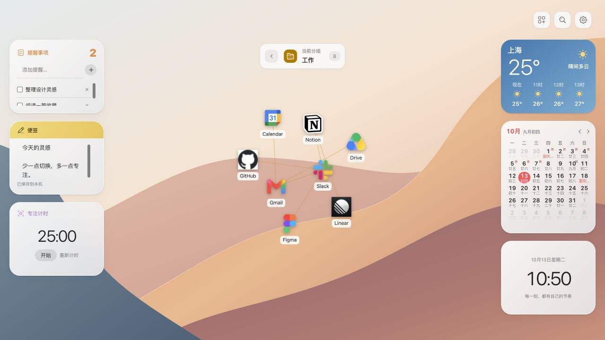

Loci 是基于 Manifest V3 的 Chrome 扩展。它直接读取浏览器中的书签和文件夹，以可缩放、可搜索的图谱呈现；日常工具沿桌面边缘摆放，打开新标签页就能继续手头的事。

- **看见收藏之间的关系**：逐层浏览文件夹、聚焦书签、固定节点，并手动建立关联。
- **快速找到下一站**：按名称、网址或分组搜索，支持快捷键与外部搜索服务。
- **搭建自己的桌面**：八类小组件，自由拖动、调整尺寸，布局保存在本机。
- **按需启用智能整理**：使用自己的模型 API Key，先预览方案，再应用或撤销。
- **本地保存，按需连接**：设置与工具数据保存在本机，天气、壁纸、行情和 AI 各自独立配置。

## 目录

- [功能预览](#功能预览)
- [快速开始](#快速开始)
- [使用指南](#使用指南)
- [开发](#开发)
- [项目结构](#项目结构)
- [权限与隐私](#权限与隐私)
- [贡献](#贡献)
- [相关文档](#相关文档)
- [许可证与素材](#许可证与素材)

## 功能预览

以下图片均为当前项目的实际界面截图，使用本地开发预览中的示例书签和演示待办。天气与 Bing 壁纸为截图时的加载结果；AI 与市场速览展示配置界面，未连接模型或行情账号。点击图片可查看原图。截图记录见 [图片说明](docs/images/README.md)。

### 书签图谱

从首页的分组进入收藏，展开当前文件夹的书签与子分组。滚轮缩放、拖动空白处平移，搜索选中节点后会切换到对应层级并聚焦。支持固定节点位置，以及通过 `Shift` + 拖拽建立书签之间的关联。

| 首页分组 | 展开书签图谱 |
| --- | --- |
| 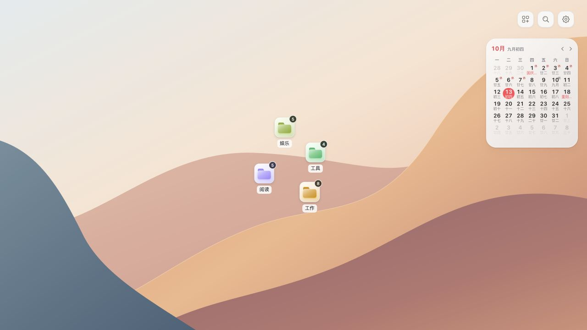 | 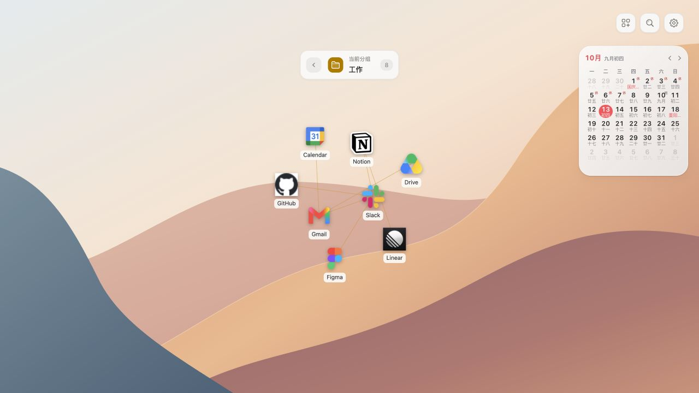 |

安装扩展后，图谱与 Chrome 原有书签保持联动；其他书签来源可在首页空白处的右键菜单中选择，受管理目录保持只读。

### 搜索与快捷访问

直接输入，或按 `⌘ / Ctrl + K` 打开搜索。支持多关键词匹配、方向键选择和回车打开；没有匹配书签时，可转到选定的搜索引擎或 AI 助手。内置多个搜索目标，也支持带 `{query}` 占位符的自定义地址。

| 即时搜索 | 搜索目标设置 |
| --- | --- |
| 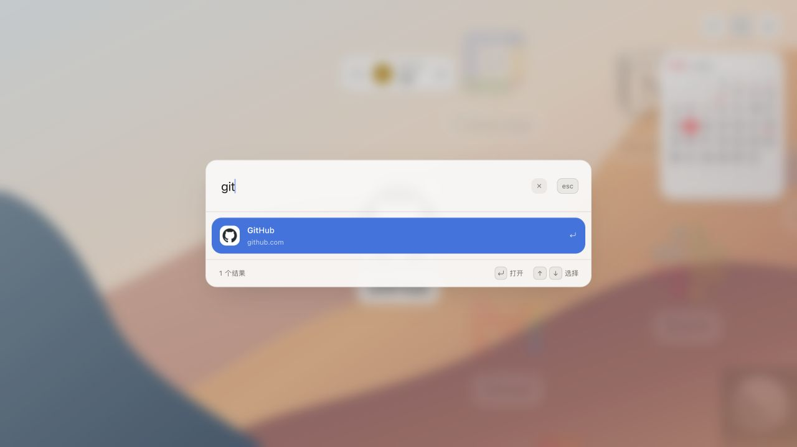 | 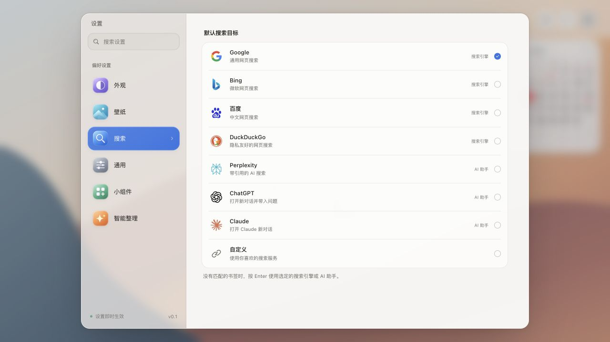 |

### 书签与分组管理

在图谱中直接添加、编辑、移动或删除书签。分组管理支持查找、新建、重命名、颜色调整和拖动层级，修改会写入 Chrome 书签系统。

| 分组管理 | 编辑书签 |
| --- | --- |
| 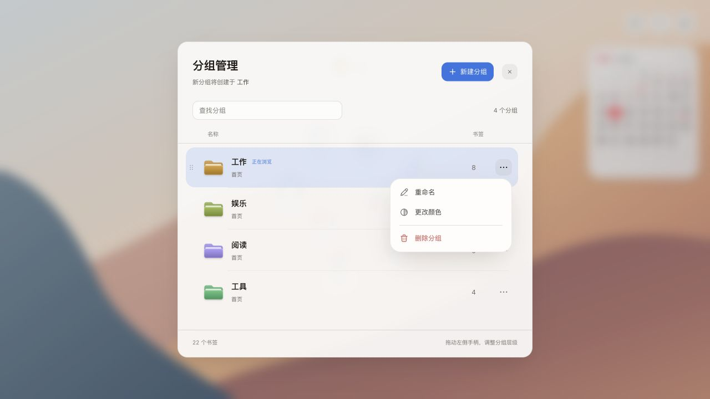 | 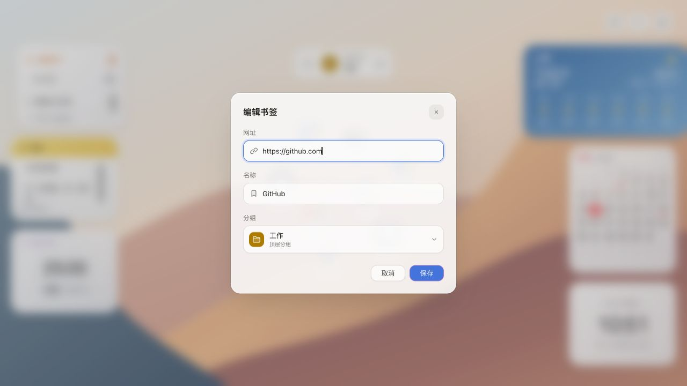 |

### 自由摆放的桌面小组件

在「设置 → 小组件」挑选工具，从右上角进入编辑模式。每张卡片都可以拖动、用方向键移动、选择小／中／大尺寸，或单独移除。小组件支持跟随系统、浅色、深色和染色外观；关闭卡片会保留数据与布局。

| 小组件图库 | 桌面布局编辑 |
| --- | --- |
| 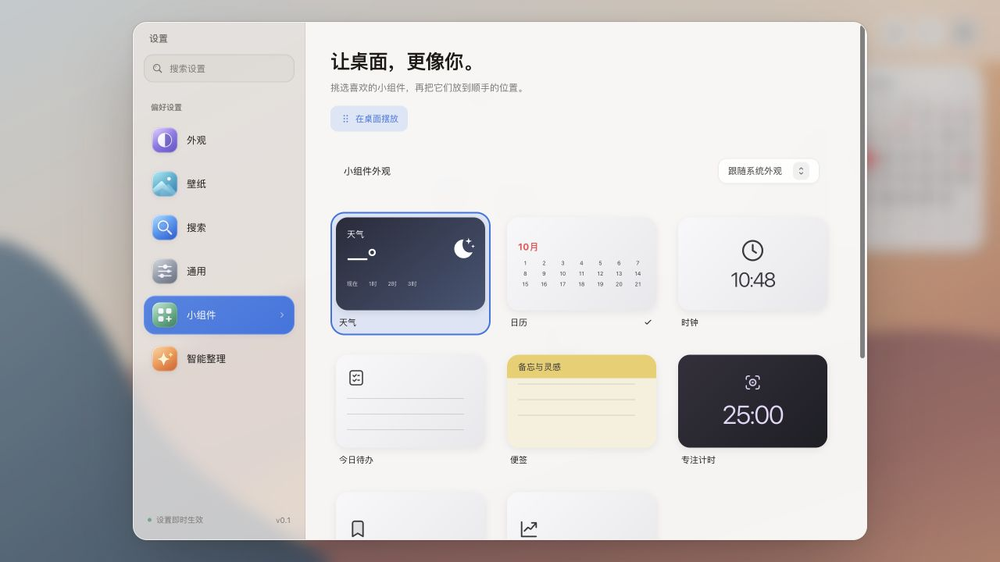 | 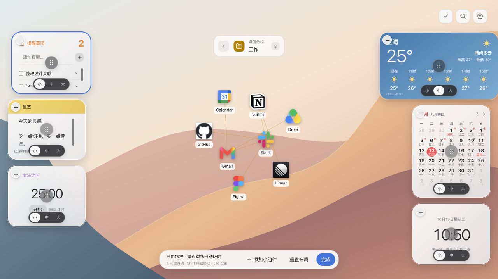 |

| 小组件 | 可以做什么 |
| --- | --- |
| 天气 | 搜索城市或一次性定位，查看当前天气、最高／最低温和逐小时预报，切换摄氏／华氏 |
| 日历 | 查看月历、农历、传统节日、放假与补班标记，支持键盘选择日期 |
| 时钟 | 显示本地时间与日期，支持 12／24 小时制 |
| 今日待办 | 直接添加、完成或删除事项，支持删除撤销与本机多标签页同步 |
| 便签 | 自动保存文字，复制内容，或在设置中把选中文字／首行转成待办 |
| 专注计时 | 开始、暂停、重置专注与休息计时，设置时长并关联待办，刷新后恢复状态 |
| 收藏回访 | 每天从全部收藏或指定文件夹中挑选一条内容，可换一条或当天跳过 |
| 市场速览 | 使用自己的 Tushare Token 查看指数、个股快照和关注列表，配置涨跌配色 |

日历默认开启，其余小组件按需添加。当前内置中国大陆 **2026 年**放假安排，其他年份显示待更新；天气须启用并选择城市后才发起预报请求。

### 收藏回访与市场速览

收藏回访在本机挑选书签，支持包含子文件夹的范围选择，帮助重新发现保存过的内容。市场速览需自行配置 Tushare Token，并具备对应接口权限；数据范围与调用额度取决于所用账号。

| 每日收藏回访 | 市场速览配置 |
| --- | --- |
| 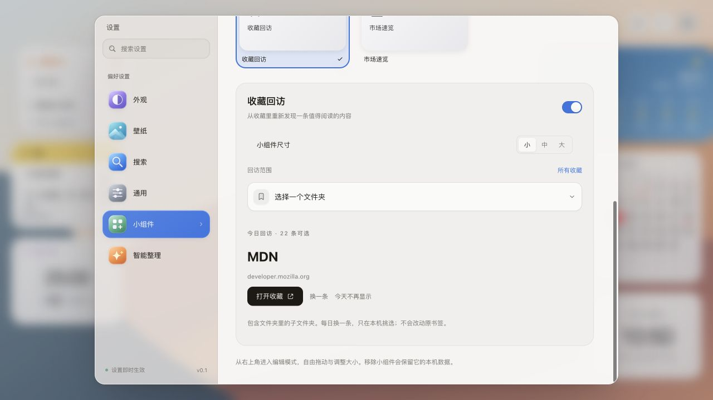 | 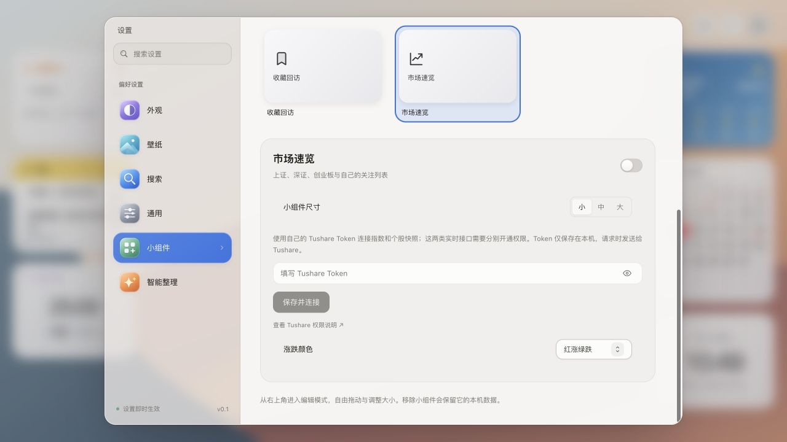 |

### 外观与每日壁纸

选择浅色、深色或跟随系统主题，搭配不同强调色。背景支持精选壁纸、纯色、颗粒、网格、自定义图片与图片链接；也可开启 Bing 每日壁纸，自动更新风景并保留摄影署名，离线时继续使用最近缓存。

| 主题与强调色 | Bing 每日壁纸与精选背景 |
| --- | --- |
| 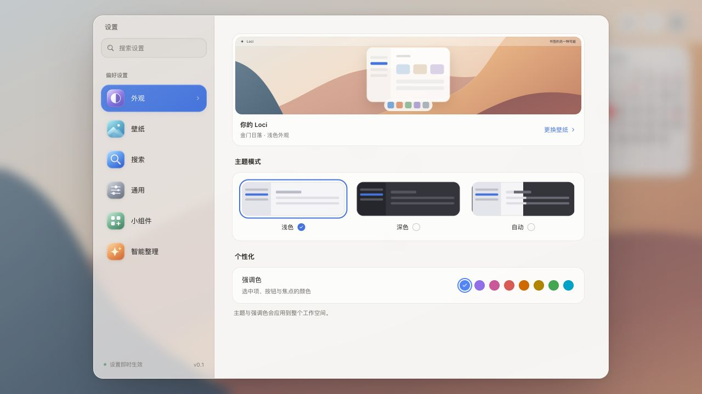 | 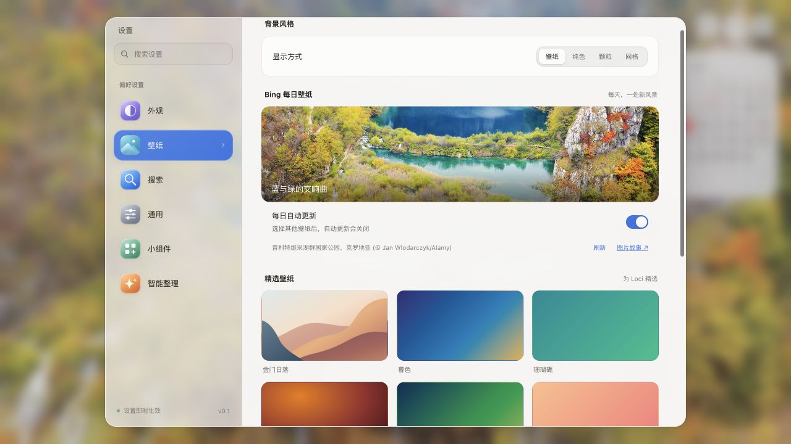 |

### AI 整理与主题分析

通过「设置 → 智能整理」配置服务商、模型与自己的 API Key，支持内置服务商和自定义兼容端点。

1. 选择未分组书签或全部书签，设置分组粒度、组名语言和是否复用已有文件夹。
2. 生成方案，预览并调整每个分组。
3. 确认后应用到 Chrome 书签；需要时可撤销上次整理，并查看执行历史。

也可以只运行主题分析，更新图谱中的主题关系而不移动书签。生成方案时会向所选服务发送书签标题、域名和分组信息；完整说明见 [隐私文档](docs/PRIVACY.md)。

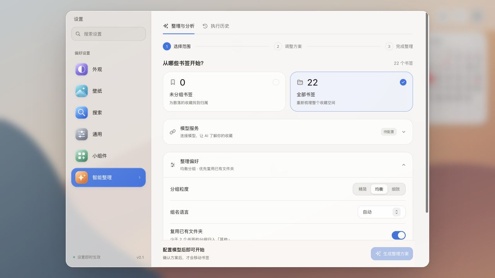

### 本地图像存储与图标缓存

上传壁纸和 Bing 图片以 Blob 保存在 IndexedDB，设置只记录图片引用。网站图标缓存默认关闭，可在「设置 → 通用」开启，选择 **7／30／90 天**更新间隔和 **5／20／50 MB**容量，并查看占用或清空缓存。超限时优先清理较少使用的图标，更新失败时保留旧缓存。

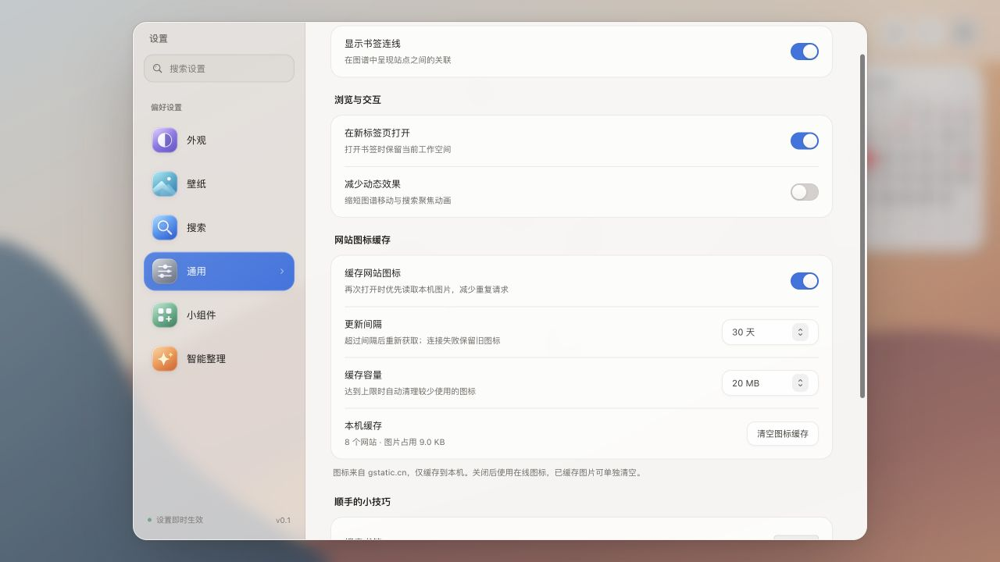

## 快速开始

### 从源码安装到 Chrome

需要 **Node.js 22.12+**、npm 和 Chrome。

```bash
git clone https://github.com/Zenyet/loci.git
cd loci
npm ci
npm run build
```

1. 打开 Chrome 的 `chrome://extensions`。
2. 开启右上角的「开发者模式」。
3. 点击「加载已解压的扩展程序」，选择项目中的 `dist/` 目录。
4. 打开新标签页，即可使用 Loci。

更新代码后重新运行 `npm run build`，在扩展管理页点击「重新加载」，再打开新标签页。

### 本地预览

```bash
npm run dev
```

访问终端显示的地址，默认是 [http://localhost:5174](http://localhost:5174)。普通网页预览使用本地示例书签，操作保存在该来源的 `localStorage` 中；安装扩展后才连接真实 Chrome 书签。天气和壁纸等在线功能仍需要网络。

## 使用指南

| 操作 | 入口或快捷键 |
| --- | --- |
| 进入分组 / 打开书签 | 点击对应节点 |
| 返回上一级 | 顶部返回按钮，或在图谱中按 `Esc` |
| 搜索书签 | 直接输入、`⌘ / Ctrl + K`，或右上角搜索按钮 |
| 选择搜索结果 | `↑` / `↓`，也支持 `Ctrl + P` / `Ctrl + N` |
| 打开搜索结果 | `Enter` |
| 添加书签 / 新建分组 | 右键图谱空白处 |
| 分组管理 | 右键空白处 → 分组管理 |
| 编辑、删除或固定书签 | 右键书签节点 |
| 建立书签关联 | `Shift` + 拖书签节点到另一个书签节点 |
| 删除关联 | 右键连线 |
| 缩放 / 平移 | 滚轮 / 拖动空白处 |
| 重置视角 | 双击空白处 |
| 配置小组件 | 设置 → 小组件 |
| 摆放小组件 | 右上角小组件按钮；聚焦移动手柄后用方向键移动，`Shift` + 方向键微调 |
| 切换日历月份 | 日历箭头，或 `Page Up` / `Page Down`；按住 `Shift` 切换年份 |
| 设置与 AI 整理 | 右上角设置按钮 |

## 开发

技术栈：**React 18、TypeScript、Vite 6、Canvas、Chrome Extensions Manifest V3、Vitest**。

项目使用 `package-lock.json` 管理 npm 依赖，建议通过 `npm ci` 安装。

| 命令 | 用途 |
| --- | --- |
| `npm run dev` | 启动 Vite 开发预览 |
| `npm run typecheck` | TypeScript 类型检查 |
| `npm run check:ui` | 检查项目 UI 控件约束 |
| `npm test` | 运行 Vitest 测试 |
| `npm run test:watch` | 监听模式运行测试 |
| `npm run build` | 构建扩展到 `dist/` |
| `npm run preview` | 预览生产构建 |
| `npm run check` | 依次执行 UI 检查、类型检查、测试和生产构建 |
| `npm run bench:canvas` | 运行 Canvas 图谱性能基准 |
| `npm run package:extension` | 构建并生成扩展 ZIP 包 |

打包命令会根据 `public/manifest.json` 的版本号生成 `release/loci-<version>.zip`。打包脚本需要系统提供 `zip` 命令，也可以手动压缩 `dist/` 中的文件。

## 项目结构

```text
loci/
├── public/             # 扩展 manifest、图标与内置壁纸
├── src/
│   ├── components/     # 通用控件、设置、书签管理与小组件
│   ├── designs/Graph/  # 图谱界面、Canvas 渲染与交互
│   ├── hooks/          # React 状态与功能逻辑
│   ├── services/       # Chrome API、存储、AI、天气与行情
│   ├── data/           # 示例数据、服务配置与节假日数据
│   ├── styles/         # 全局样式与设计变量
│   └── types.ts        # 类型定义与默认设置
├── docs/               # 隐私说明、功能截图、设计与开发文档
├── scripts/            # 控件检查、性能基准与扩展打包
└── package.json        # 依赖与开发命令
```

## 权限与隐私

书签保留在 Chrome 原有书签系统中；设置、待办、便签、布局与功能缓存保存在本机。Chrome 自身的书签同步取决于浏览器账号设置，Loci 的本机工具数据不会因此自动跨设备同步。

| 权限或服务 | 用途与触发方式 |
| --- | --- |
| `bookmarks` | 读取、创建、编辑、移动和删除书签与文件夹 |
| `history` | 聚合访问频次，用于图谱节点权重 |
| `topSites` | 书签为空时提供常用站点兜底 |
| `storage` | 保存设置、布局、待办和功能缓存 |
| `geolocation` | 仅在点击「使用当前位置」时定位一次 |
| Open-Meteo 域名（可选） | 启用天气时申请，用于城市搜索和预报 |
| BigDataCloud 域名（可选） | 点击定位时申请，将坐标识别为城市 |
| Bing 域名（可选） | 开启每日壁纸时申请，下载图片与署名信息 |
| `t0.gstatic.cn`（可选） | 开启图标缓存时申请，下载图标到本机 |
| Tushare 域名（可选） | 主动连接行情服务时申请，使用自备 Token 查询 |
| 所选 AI 服务 | 配置并手动触发后发送整理或主题分析所需信息 |

在线图标通过 `t0.gstatic.cn/faviconV2` 加载，只发送公开主机名；跳过本机名称和 IP 地址，失败时显示首字母。关闭持久缓存后仍会在线加载图标。

API Key 和 Tushare Token 保存在本机，并非加密保险箱。数据字段、缓存行为、权限撤回与第三方服务说明见 [完整隐私文档](docs/PRIVACY.md)。

## 贡献

欢迎通过 [Issues](https://github.com/Zenyet/loci/issues) 反馈问题，或提交 Pull Request。

1. 创建分支并完成修改；问题反馈请附复现步骤和界面截图。
2. 遵循 [AGENTS.md](AGENTS.md) 中的项目约束，复用现有自定义控件。
3. 运行 `npm run check`。涉及控件交互时，验证键盘操作、焦点恢复和菜单边界。
4. 功能或界面发生变化时，同步更新 README 与相关截图。

## 相关文档

- [隐私与数据使用](docs/PRIVACY.md)
- [功能截图说明](docs/images/README.md)
- [Canvas 性能记录](docs/performance/canvas-2026-09-20.md)
- [产品路线图（历史规划）](docs/plans/2026-09-18-product-roadmap.md)
- [Chrome Web Store 0.1.3 上传资料（历史发布记录）](docs/chrome-store/0.1.3/UPLOAD-GUIDE.txt)

历史规划和发布资料可能与当前源码不同，当前功能以本 README 和实际界面为准。

## 许可证与素材

仓库当前未提供项目级 `LICENSE` 文件。第三方服务与素材适用各自条款：天气来自 [Open-Meteo](https://open-meteo.com/)，每日壁纸保留 Bing 返回的摄影署名，搜索服务图标说明见 [素材记录](public/licenses/search-provider-logos.txt)。
